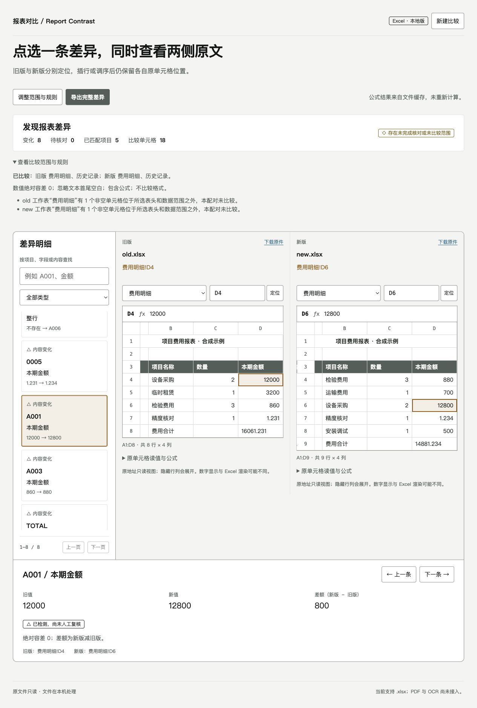

# Excel 首版验证记录

验证日期：2026-11-04。对象为当前本地工作区，使用合成工作簿；尚未使用用户的真实业务报表验证。

## 自动化与构建

- `.venv/bin/python -m pytest -q`：26 passed，耗时 1.31 秒。
- `npm run build --prefix frontend`：TypeScript 检查与 Vite 生产构建通过。
- 运行中服务 `GET /api/health`：返回 `{"status":"ok","version":"0.1.0"}`。
- 测试输出含一条 FastAPI/Starlette TestClient 对 httpx 的弃用提示，不影响本次通过结果。

自动化覆盖 Excel 提取、比较引擎与 API：行重排定位、增删项目、数值精度与容差、公式文本/缓存、重复键和缺失键、合并表头、隐藏行列、原件字节不变、持久化恢复、125 条差异分页及全量导出、400 列配置导出不截断、非法文件与外部来源请求拒绝等。详细断言保存在 `tests/`。

## 实际浏览器验证

在 `http://127.0.0.1:8765` 中使用页面文件选择器导入 `examples/old.xlsx` 与 `examples/new.xlsx`，保留建议工作表配对，以第 3 行为费用明细表头、项目编码为业务键。

| 场景 | 实际结果 |
|---|---|
| 导入两份真实 XLSX 并执行比较 | 成功，8 条差异：4 条内容变化、1 条公式变化、2 条新增、1 条删除 |
| 点击 A001 金额差异 | 旧版 `费用明细!D4` 为 12000；新版 `费用明细!D6` 为 12800；差额 800 |
| 删除项目 | A002 定位旧版 A5，新版明确显示无对应位置 |
| 同一单元格的值差异与公式差异连续切换 | 两侧原文正常显示，定位 D8 / D9，未清空 |
| 搜索 0005 | 只返回精度差异 `1.231 → 1.234`，保留编号前导零 |
| 筛选公式变化 | 只返回 TOTAL 的 1 条公式差异 |
| 刷新结果页 | 根据地址中的任务和结果编号恢复 8 条差异，可继续点选定位 |
| 点击导出完整差异 | 成功下载 XLSX；重新读取确认包含摘要、全部差异、待核对、范围与规则四表；差异数据 8 行，公式文本均作为字符串写入 |
| 浏览器控制台 | 本次检查无 error / warn 记录 |

截图：

## 验证边界

- 本次实际浏览器检查使用桌面尺寸；窄屏、系统深色模式未在此次运行中验证。
- 125 条分页、重复键等边界由自动化 API/引擎测试验证，未逐一在浏览器中重复执行。
- 原单元格定位是应用内只读工作表视图，不会驱动桌面 Excel；并非 Excel 打印布局的像素级复刻。
- Excel 公式不重新计算；缓存缺失会列为待核对。标题等未纳入所选表头与数据范围的非空格明确提示未比较。
- PDF、OCR、`.xls`、`.xlsm`、图表/图片视觉差异未实现、未验证。未做大型生产文件的压力测试。
