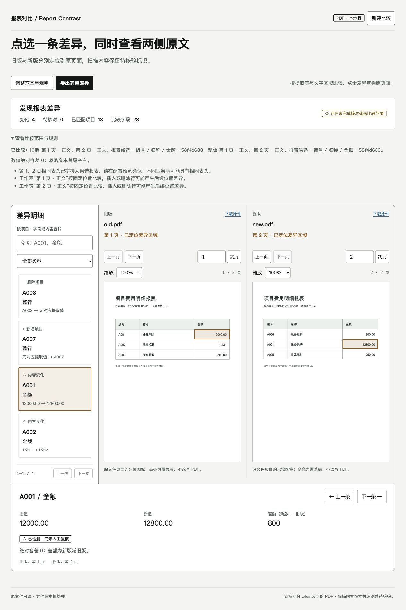
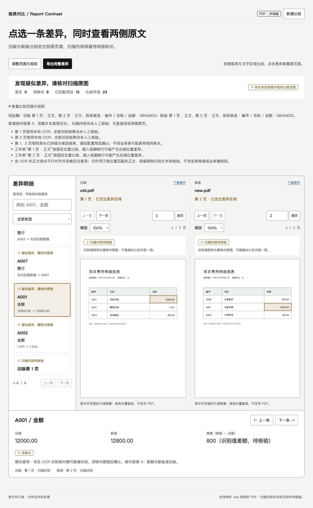

# PDF / OCR 实施验证记录

日期：2026-11-04。当前本地应用版本 0.2.0，验证环境为本机 macOS / Python 3.11。测试使用合成中文报表及针对性边界夹具，未使用用户真实业务报表。

## 已运行结果

- `.venv/bin/python -m pytest -q`：**48 passed，9.40 秒**。包含原有 Excel 26 项、PDF 提取与比较 16 项、PDF API 6 项。
- `npm run build --prefix frontend`：TypeScript 与 Vite 生产构建通过。
- 实际服务已重启，`GET /api/health` 返回版本 0.2.0。
- 有一条 FastAPI/Starlette TestClient 使用 httpx 的弃用提示，不影响测试结果。

## 真实文件与 OCR

`scripts/make_pdf_examples.py` 生成两页中文文本 PDF，并渲染为图片嵌回 PDF 制成扫描版。扫描版每页无文本层；四份样例重复生成的 SHA-256 一致。已知差异和单元格坐标见 `examples/pdf/expected.json`。

| 场景 | 运行结果 |
|---|---|
| 旧、新文本 PDF | 4 条差异：A003 删除，A007 新增，A001 金额增加 800，A002 金额增加 0.003 |
| 跨页重新排布 | A001 旧第 1 页对应新第 2 页；A004 仅换页不报内容变化 |
| 旧、新扫描 PDF，真实本机 OCR | 4 条疑似差异与 4 条整页核验；不将 OCR 结果标为确定变化 |
| 同一扫描文件比较自身 | 只有页面核验入口，没有疑似变化 |
| 同一原件的文本版与扫描版 | 只有扫描侧 2 条页面核验，没有正文分段产生的疑似变化 |
| 旧文本版与新扫描版 | 4 条疑似差异与扫描侧 2 条页面核验 |
| 原生文本标题＋面积小于 15% 的扫描表 | 实际 OCR/API 回归检出金额 100 → 200，未被标题或图片面积阈值跳过 |
| 空白页、模拟 OCR 失败 | 明确返回提取不可用，保留原页图像，不返回内容一致 |
| 无可靠网格的 OCR 内容 | 单列文字块与结构待确认提示；测试中模拟识别结果来隔离结构逻辑 |
| 原件与导出 | API 验证上传、下载字节一致；导出保留全部事件、页码与区域，原始文件不改写 |

OCR 实际使用 `rapidocr-onnxruntime==1.4.4` 包内的 `ch_PP-OCRv4_det_infer.onnx`、`ch_PP-OCRv4_rec_infer.onnx` 和 `ch_ppocr_mobile_v2.0_cls_infer.onnx`。未调用云端 OCR。单页中文样例识别曾测得 0.57 秒，仅为该样例一次运行值，不是性能承诺。

## 浏览器端到端

使用内置浏览器真实文件选择器分别导入文本样例和扫描样例，经配置确认执行比较；未以 mock 响应替代本节结果。

- 点击 A001 后两侧分别展示旧第 1 页、新第 2 页；原页面中 12000.00 和 12800.00 所在金额格被高亮。
- 缩放旧侧至 200%、手工翻动新侧页面，再次点击相同差异后恢复对应页；高亮相对图像位置保持一致。
- 文本侧金额格的浏览器归一化位置约为 `[0.65851, 0.24236, 0.91889, 0.29463]`，对应夹具旧页 `x=392..547, top=204..248` point 的已知区域。
- 刷新恢复任务；扫描标题显示“发现疑似差异，请核对扫描原图”；差额显示“800（识别值差额，待核验）”。
- 真实点击下载扫描差异报告后重新读取：4 个工作表、8 条完整事件、8 条待核对事件，包含页码，未产生可执行公式单元格。
- 保留原有 Excel 任务并刷新，仍得到 8 条差异，A001 定位旧 D4 / 新 D6。
- 最终扫描结果页检查无浏览器 error / warn；已保存并查看完整页面截图。

前端代理另外使用 mock 后端验证了 1440 / 390 宽度、空提取页面、无差异原页浏览及混传拒绝。这些属于独立 UI 检查，不替代真实 PDF/OCR 运行；主代理实际浏览器联调使用当前桌面尺寸。

## 坐标及修复

自动化运行验证了 0/90/180/270 度页面旋转、非零 CropBox、UserUnit=2 时的归一化位置、页面边界和渲染图像中的对应墨迹。未做全组合 DPR/缩放/旋转的逐像素误差测量，不宣称所有组合均达到 2 CSS px 误差标准。

本轮复核修正了两类有真实复现的漏报/误报：小扫描表因面积阈值被跳过；原生与 OCR 正文分行方式不同导致同源文件出现伪差异。另补上 PDFium 渲染串行锁、逻辑候选与原始页表重复比较拒绝、整页来源导出兼容、全空 PDF 的问题查看入口。

## 当前边界

- 使用同源原页 PNG 与归一化覆盖层，属于原页面只读渲染，不是 PDF.js 文本选择/注释编辑器。
- OCR 是识别结果，仍可能漏字、错值、错行列。含图片标志的文本页也可能保守进入 OCR 核验状态。
- 同表头跨页拼接是候选，用户在配置中确认；同表头不自动等于同一业务报表。
- 正文位置模式不解决任意段落重排；含 OCR 的正文比较忽略空白差异，并保留原文与规则提示。
- 未实现人工校正/已核验状态持久化、手动框选重识别、图表/图片/签章的像素变化比较。
- 尚未完成低清、严重倾斜、复杂无框表的实测数据集评估、大型文件压测、Windows/Linux 运行验证。
